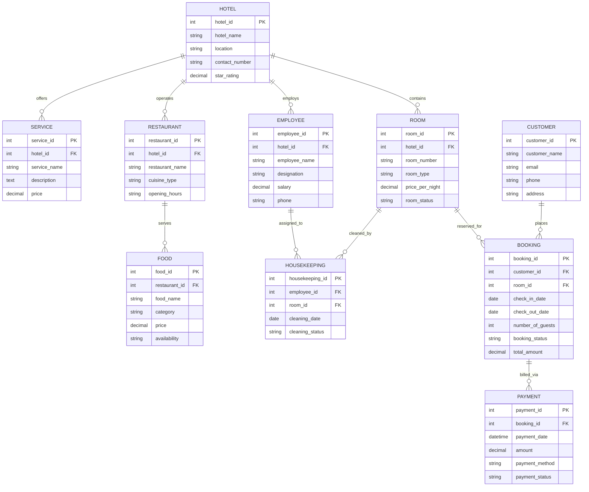

# Database Schema Documentation — Hotel Management System

## 1. Database Overview

- **Database Name**: `hotel_management`
- **RDBMS Engine**: MySQL 8.0 (InnoDB)
- **Character Set**: `utf8mb4`
- **Collation**: `utf8mb4_unicode_ci`
- **Total Entities**: 10 relational tables
- **Total Seed Records**: 114 deterministic records across all tables

The schema is normalized to **Third Normal Form (3NF)** to eliminate data redundancy while maintaining relational integrity across hotels, rooms, guests, employees, reservations, billing, and facilities.

---

## 2. Entity-Relationship Diagram (ERD)

---

## 3. Detailed Table Specifications & Constraints

### 3.1 HOTEL
Stores central details regarding property locations, contacts, and classifications.
- `hotel_id` INT AUTO_INCREMENT PRIMARY KEY
- `hotel_name` VARCHAR(100) NOT NULL
- `location` VARCHAR(200) NOT NULL
- `contact_number` VARCHAR(20) NOT NULL
- `star_rating` DECIMAL(2,1) NOT NULL
- `created_at` TIMESTAMP DEFAULT CURRENT_TIMESTAMP
- **Constraints**:
  - `chk_hotel_star_rating`: `CHECK (star_rating >= 1.0 AND star_rating <= 5.0)`

### 3.2 ROOM
Stores individual room inventory belonging to a hotel.
- `room_id` INT AUTO_INCREMENT PRIMARY KEY
- `hotel_id` INT NOT NULL (FK &rarr; `HOTEL.hotel_id` ON DELETE CASCADE)
- `room_number` VARCHAR(10) NOT NULL
- `room_type` VARCHAR(50) NOT NULL
- `price_per_night` DECIMAL(10,2) NOT NULL
- `room_status` VARCHAR(20) NOT NULL DEFAULT 'Available'
- `created_at` TIMESTAMP DEFAULT CURRENT_TIMESTAMP
- **Constraints**:
  - `uk_hotel_room`: `UNIQUE (hotel_id, room_number)`
  - `chk_room_price`: `CHECK (price_per_night > 0)`
  - `chk_room_status`: `CHECK (room_status IN ('Available', 'Occupied', 'Maintenance'))`
  - `chk_room_type`: `CHECK (room_type IN ('Single', 'Double', 'Deluxe', 'Suite', 'Presidential Suite'))`

### 3.3 CUSTOMER
Stores verified profiles of registered guests.
- `customer_id` INT AUTO_INCREMENT PRIMARY KEY
- `customer_name` VARCHAR(100) NOT NULL
- `email` VARCHAR(100) NOT NULL UNIQUE
- `phone` VARCHAR(20) NOT NULL
- `address` VARCHAR(255) NOT NULL
- `created_at` TIMESTAMP DEFAULT CURRENT_TIMESTAMP

### 3.4 EMPLOYEE
Stores staff members across executive, culinary, front desk, and housekeeping roles.
- `employee_id` INT AUTO_INCREMENT PRIMARY KEY
- `hotel_id` INT NOT NULL (FK &rarr; `HOTEL.hotel_id` ON DELETE CASCADE)
- `employee_name` VARCHAR(100) NOT NULL
- `designation` VARCHAR(50) NOT NULL
- `salary` DECIMAL(10,2) NOT NULL
- `phone` VARCHAR(20) NOT NULL
- `created_at` TIMESTAMP DEFAULT CURRENT_TIMESTAMP
- **Constraints**:
  - `chk_employee_salary`: `CHECK (salary > 0)`

### 3.5 BOOKING
Core transactional entity representing room reservations.
- `booking_id` INT AUTO_INCREMENT PRIMARY KEY
- `customer_id` INT NOT NULL (FK &rarr; `CUSTOMER.customer_id` ON DELETE RESTRICT)
- `room_id` INT NOT NULL (FK &rarr; `ROOM.room_id` ON DELETE RESTRICT)
- `check_in_date` DATE NOT NULL
- `check_out_date` DATE NOT NULL
- `number_of_guests` INT NOT NULL DEFAULT 1
- `booking_status` VARCHAR(20) NOT NULL DEFAULT 'Pending'
- `total_amount` DECIMAL(10,2) NOT NULL DEFAULT 0.00
- `created_at` TIMESTAMP DEFAULT CURRENT_TIMESTAMP
- **Constraints**:
  - `chk_booking_dates`: `CHECK (check_out_date >= check_in_date)`
  - `chk_booking_guests`: `CHECK (number_of_guests > 0)`
  - `chk_booking_status`: `CHECK (booking_status IN ('Confirmed', 'Pending', 'Cancelled', 'Completed'))`
  - `chk_booking_amount`: `CHECK (total_amount >= 0)`

### 3.6 PAYMENT
Stores billing records and settlement channel receipts.
- `payment_id` INT AUTO_INCREMENT PRIMARY KEY
- `booking_id` INT NOT NULL (FK &rarr; `BOOKING.booking_id` ON DELETE CASCADE)
- `payment_date` DATETIME NOT NULL DEFAULT CURRENT_TIMESTAMP
- `amount` DECIMAL(10,2) NOT NULL
- `payment_method` VARCHAR(50) NOT NULL
- `payment_status` VARCHAR(20) NOT NULL DEFAULT 'Pending'
- `created_at` TIMESTAMP DEFAULT CURRENT_TIMESTAMP
- **Constraints**:
  - `chk_payment_amount`: `CHECK (amount > 0)`
  - `chk_payment_method`: `CHECK (payment_method IN ('Credit Card', 'Debit Card', 'UPI', 'Net Banking', 'Cash'))`
  - `chk_payment_status`: `CHECK (payment_status IN ('Completed', 'Pending', 'Failed', 'Refunded'))`

### 3.7 RESTAURANT
Stores dining outlets located within hotel properties.
- `restaurant_id` INT AUTO_INCREMENT PRIMARY KEY
- `hotel_id` INT NOT NULL (FK &rarr; `HOTEL.hotel_id` ON DELETE CASCADE)
- `restaurant_name` VARCHAR(100) NOT NULL
- `cuisine_type` VARCHAR(50) NOT NULL
- `opening_hours` VARCHAR(100) NOT NULL
- `created_at` TIMESTAMP DEFAULT CURRENT_TIMESTAMP

### 3.8 FOOD
Stores menu items offered at each restaurant.
- `food_id` INT AUTO_INCREMENT PRIMARY KEY
- `restaurant_id` INT NOT NULL (FK &rarr; `RESTAURANT.restaurant_id` ON DELETE CASCADE)
- `food_name` VARCHAR(100) NOT NULL
- `category` VARCHAR(50) NOT NULL
- `price` DECIMAL(10,2) NOT NULL
- `availability` VARCHAR(20) NOT NULL DEFAULT 'Available'
- `created_at` TIMESTAMP DEFAULT CURRENT_TIMESTAMP
- **Constraints**:
  - `chk_food_category`: `CHECK (category IN ('Appetizer', 'Main Course', 'Dessert', 'Beverage', 'Snacks'))`
  - `chk_food_price`: `CHECK (price > 0)`
  - `chk_food_availability`: `CHECK (availability IN ('Available', 'Out of Stock'))`

### 3.9 SERVICE
Stores guest amenities, recreation, and business facilities.
- `service_id` INT AUTO_INCREMENT PRIMARY KEY
- `hotel_id` INT NOT NULL (FK &rarr; `HOTEL.hotel_id` ON DELETE CASCADE)
- `service_name` VARCHAR(100) NOT NULL
- `description` TEXT
- `price` DECIMAL(10,2) NOT NULL DEFAULT 0.00
- `created_at` TIMESTAMP DEFAULT CURRENT_TIMESTAMP
- **Constraints**:
  - `chk_service_price`: `CHECK (price >= 0)`

### 3.10 HOUSEKEEPING
Operational log of room cleanings and inspections by staff.
- `housekeeping_id` INT AUTO_INCREMENT PRIMARY KEY
- `employee_id` INT NOT NULL (FK &rarr; `EMPLOYEE.employee_id` ON DELETE CASCADE)
- `room_id` INT NOT NULL (FK &rarr; `ROOM.room_id` ON DELETE CASCADE)
- `cleaning_date` DATE NOT NULL
- `cleaning_status` VARCHAR(30) NOT NULL DEFAULT 'Pending Inspection'
- `created_at` TIMESTAMP DEFAULT CURRENT_TIMESTAMP
- **Constraints**:
  - `chk_housekeeping_status`: `CHECK (cleaning_status IN ('Clean', 'In Progress', 'Pending Inspection', 'Dirty'))`

---

## 4. Indexing Strategy

To guarantee rapid query performance for front-desk operations and real-time analytics, composite and single-column B-Tree indexes are defined:

1. `idx_room_hotel_status` on `ROOM(hotel_id, room_status)`: Accelerates available room filtering.
2. `idx_room_type` on `ROOM(room_type)`: Accelerates category lookups.
3. `idx_room_price` on `ROOM(price_per_night)`: Accelerates price range and sorting operations.
4. `idx_booking_customer` on `BOOKING(customer_id)`: Speeds up customer profile joins.
5. `idx_booking_room` on `BOOKING(room_id)`: Speeds up room overlap checks.
6. `idx_booking_dates` on `BOOKING(check_in_date, check_out_date)`: Accelerates date filtering.
7. `idx_booking_status` on `BOOKING(booking_status)`: Speeds up KPI aggregations.
8. `idx_payment_booking` on `PAYMENT(booking_id)`: Optimizes invoice joins.
9. `idx_payment_status` on `PAYMENT(payment_status)`: Accelerates revenue queries.
10. `idx_food_restaurant_category` on `FOOD(restaurant_id, category)`: Fast menu retrieval.
11. `idx_housekeeping_room` on `HOUSEKEEPING(room_id)`: Rapid housekeeping status lookup.
